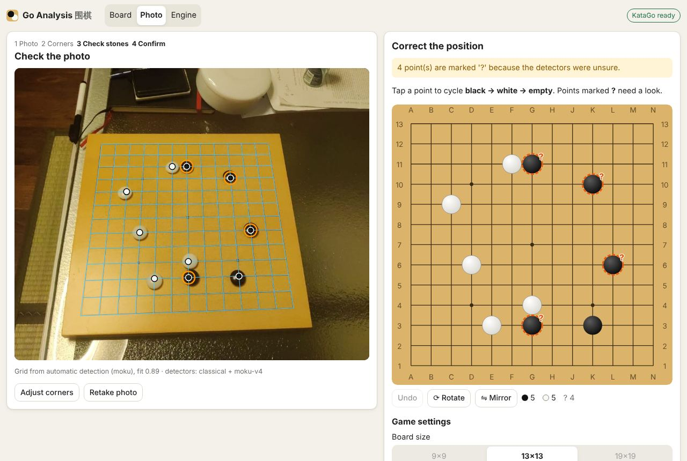
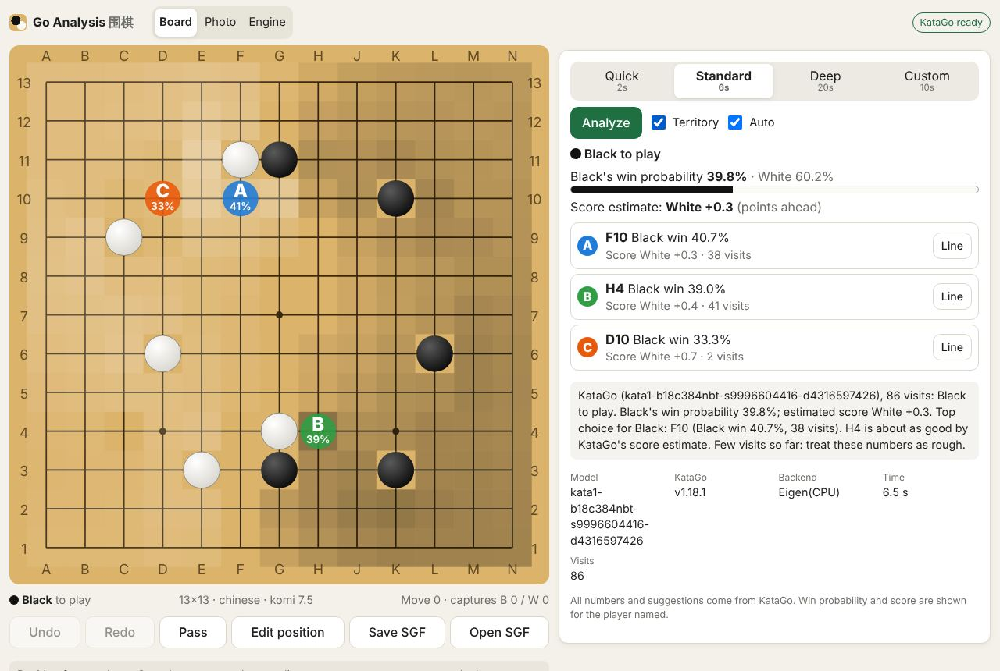
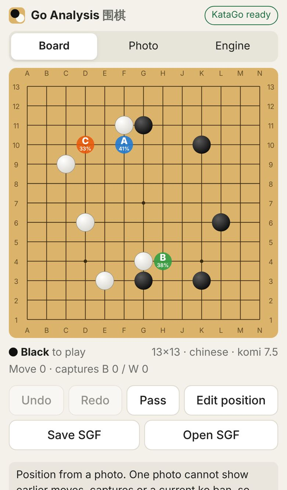

# Go / 围棋 photo analysis

Photograph a physical Go board with your iPhone, or choose a photo. Your Mac reconstructs the position, you check and correct it, and **KataGo** analyses it on the Mac's GPU. No cloud AI and no internet are needed after installation.

- **Photo → position:** 9×9, 13×13 and 19×19.
  - Handles iPhone EXIF orientation and HEIC.
  - Detects the grid automatically (OpenCV plus the optional moku-v4 neural detector).
  - Lets you drag the four corners by hand, with a magnifier, when detection is unsure. It never invents a board.
  - Marks uncertain stones with **?**; you tap to correct and can undo, rotate or mirror.
  - Requires an explicit *Confirm position* before any analysis.
- **Real KataGo analysis:**
  - Native Apple Silicon **Metal** backend via Homebrew, with current kata1 transformer networks.
  - Quick / Standard / Deep thinking presets or a custom time.
  - Top three moves on the board, with win probability and score lead labelled with whose they are, and visits.
  - Clickable principal variations you can step through, and a territory (ownership) heatmap.
  - Shows the model, KataGo version, backend, time and visits.
- **Correct Go state:**
  - You choose board size, side to move, rules (Chinese by default) and komi.
  - A photo becomes KataGo's *initial position*; no move history is invented.
  - Moves you play afterwards are real history: captures, ko, pass, undo and redo all apply.
  - SGF import and export.
- **Phone ↔ Mac:**
  - Localhost-only by default. `--lan` lets your phone connect after scanning a pairing QR code.
  - Optional `--https`, with a private certificate authority, for the live camera preview.
- **Remote access with sign-in:** `--tunnel` makes the app reachable from anywhere through a Cloudflare Tunnel.
  - Every device except the Mac signs in with a username and password, which you set and change under *Engine → Account*.

| Check the photo, correct the stones | Analysis (desktop) | Analysis (iPhone size) |
|---|---|---|
|  |  |  |

*Screenshots from the cloud test run (KataGo CPU build). On the Mac the backend line reads Metal.*

> **Status of device testing.** Everything was built and tested on a Linux cloud machine, using KataGo's official CPU (Eigen) build and real kata1 networks, and headless Chromium at iPhone and desktop sizes. It has **not** been run on an M1 Mac (Metal speed, memory and the default network choice) or on a physical iPhone (Safari, camera, HEIC, Wi-Fi). See [What was verified](#what-was-verified) and the [checklist for your devices](#checklist-for-your-mac-and-iphone).

## Requirements

- Apple Silicon Mac (M1 or newer), **macOS 14 Sonoma or newer**, about 1.5 GB free disk.
- [Homebrew](https://brew.sh). The setup script uses it to install `katago`, `uv`, `node` and `cloudflared`.
- Internet access during installation only (Homebrew, Python and npm packages, about 0.3 GB of networks).
- An iPhone on the same Wi-Fi network as the Mac (optional: the Mac's own browser works too).

## Install

```bash
git clone https://github.com/DreamingWilliamChu/go_bot.git
cd go_bot
git checkout claude/magical-allen-9xq915   # the branch this work is on (skip once merged)
./scripts/setup_mac.sh                     # add --max to also download the strongest network (262 MB)
./scripts/benchmark.sh --quick             # ~10-20 min: measures your Mac, picks the default network
```

`setup_mac.sh` does the following. It is safe to re-run.

1. Checks the chip, RAM and macOS version.
2. Installs `katago` (built with Metal on Apple Silicon), `uv` and `node` with Homebrew.
3. Runs `uv sync --frozen` and builds the web app (`npm ci && npm run build`).
4. Downloads the networks listed in [`models/manifest.json`](models/manifest.json), verifying size and sha256.
5. Records the hardware to `data/hardware.json`.

## Start

```bash
./scripts/start.sh            # this Mac only: open http://localhost:8000
./scripts/start.sh --lan      # also your iPhone: scan the QR code printed in the terminal
./scripts/start.sh --lan --https   # + live camera preview on the iPhone (one-time certificate install)
./scripts/start.sh --tunnel   # from anywhere, through Cloudflare (set a sign-in password first)
                              # with your own domain set up, plain ./scripts/start.sh connects to it
```

Stop with `Ctrl+C`. The phone setup, the certificate steps and troubleshooting are in [docs/PHONE_SETUP.md](docs/PHONE_SETUP.md). Sign-in and remote access are described in [docs/REMOTE_ACCESS.md](docs/REMOTE_ACCESS.md).

## Update

```bash
cd go_bot
./scripts/update.sh           # git pull + setup (dependencies, web app, any new networks)
./scripts/benchmark.sh --quick   # optional, if networks changed
```

## Using the app

1. **Photo tab.** Pick the board size, then **Take a photo** or **Choose a photo**. Keep all four corners in view and hold the phone above the board.
2. If the grid was not found confidently, drag the four red handles onto the **outermost line crossings**. The blue preview grid should then sit on the board lines.
3. **Check stones.** Points marked **?** need a look. Tap a point to cycle black → white → empty. **Undo**, **Rotate** and **Mirror** are available.
4. Choose **who plays next** (required), the rules and komi, then **Confirm position & analyze**.
5. **Board tab.** Watch the analysis. **A/B/C** mark KataGo's top three moves. Tap **Line** to see and step through a variation. *Territory* toggles the ownership map. Play moves on the board; with *Auto* on, each move is analysed. **Edit position** places stones freely; **Save/Open SGF** exports or imports.

One photo cannot show which moves led to the position or whether a ko is currently forbidden, so KataGo treats a photo as a fresh position with the side to move you chose. Moves you enter afterwards are kept and used.

## Networks and strength

| Profile | Network | kata1 Elo¹ | Size | Default download |
|---|---|---|---|---|
| Maximum strength | `kata1-tf3-b11c768` (transformer) | 14602 | 262 MB | `--max` |
| Strong default (before benchmarking) | `kata1-tf3-b10c512` (transformer) | 14167 | 94 MB | yes |
| Light / fast | `kata1-tf2-b10c384` (transformer) | 13707 | 38 MB | yes |
| Compatibility fallback | `kata1-b18c384nbt` (convolutional) | 13620 | 98 MB | from Homebrew |

¹ From KataGo's training-run rating games, not measured at a fixed thinking time on an M1.

`./scripts/benchmark.sh` measures visits per second, memory and visits per preset for each installed network on your Mac. It then saves the network with the best kata1 Elo after a speed penalty (150 Elo for each halving of visits below 1,000 in the 6-second Standard preset; the 150 is an assumption), among those using at most 35% of RAM. Details, the selection rule and the cloud measurements are in [docs/MODELS.md](docs/MODELS.md). You can switch networks at any time on the **Engine** tab. If a network fails to load (for example, out of memory), the app falls back to the light network and then to the convolutional one, and tells you.

## Commands

| Command | What it does |
|---|---|
| `./scripts/setup_mac.sh [--max] [--no-models]` | Install or refresh everything |
| `./scripts/start.sh [--lan] [--https] [--tunnel] [--port N] [--model ID] [--new-token]` | Run the app |
| `uv run gobot account set [--username U] \| show \| logout-all` | Set the sign-in password, or sign out every device |
| `uv run gobot tunnel create --hostname H \| setup --hostname H \| token \| show` | Remote access on your own domain (see docs/REMOTE_ACCESS.md) |
| `./scripts/benchmark.sh [--quick] [--models …] [--modes gpu mux] [--no-select]` | Benchmark and pick the default network |
| `./scripts/download_models.sh [--max \| --all \| ids…]` | Download networks or moku (sha256-checked) |
| `./scripts/update.sh` | Pull and refresh |
| `uv run gobot models list` | Show installed networks |
| `./scripts/fetch_test_data.sh && uv run gobot eval` | Recognition accuracy on the public test sets (and your saved test cases) |

## What was verified

All of the following ran in a Linux cloud VM (x86-64, 4 cores, no GPU):

- **Real KataGo integration:** official v1.18.1 Eigen build, real kata1 networks; all five networks load and answer, including the transformers.
  - Tested: initial-stones photo positions with either side to move on 9×9, 13×13 and 19×19; captures; pass; illegal-move errors; rules and komi changes; cancellation; superseded requests not delivering stale results; and the analysis websocket.
  - Crash, hang, failed start and missing weights are tested with a protocol test double.
- **Rules and SGF:** coordinate conversions (one shared fixture for Python and TypeScript), captures, suicide, simple ko, pass, undo/redo, and SGF round trips, including setup stones and handicap.
- **Photo recognition:** measured on real annotated photos; see [docs/RECOGNITION.md](docs/RECOGNITION.md).
  - Tengen-Go 13×13 phone photos: grid found on 100%, 75% of boards perfect, 0.25 wrong points per board, all of them flagged "?".
  - No wrong grid was accepted on any test set.
  - EXIF orientations 1–8 and HEIC decoding are tested.
- **Browser:** headless Chromium at iPhone 13, iPhone SE and desktop sizes.
  - Tested: move entry with real analysis, PV stepping, SGF download and upload, photo upload, correction and undo, the mandatory next-player choice, confirm, and the unreadable-photo and wrong-board-size paths.
  - No horizontal overflow at these sizes.
- **LAN and HTTPS:** pairing token, cookie and websocket auth over TLS verified against the generated CA, and the CA download helper.
  - In Chromium with the CA trusted: secure context, live camera preview (fake camera) and capture → upload.
  - Pairing link in the browser over HTTP LAN.
  - Chromium-to-LAN HTTPS and websockets could not be tested from the browser here because the sandbox network intercepts them; they were tested from Python instead.

## Checklist for your Mac and iPhone

These could not be verified in the cloud. Please check them; each takes a minute or two.

1. `./scripts/setup_mac.sh` finishes, and `katago version` reports the **Metal** backend.
2. `./scripts/benchmark.sh --quick` completes. Note the visits/s and peak memory in `data/benchmark/report.md` and which network it selected; transformer nets on Metal are the main unknown.
3. In `./scripts/start.sh`, the Engine tab shows *KataGo ready*, the Metal backend and the selected network.
4. `./scripts/start.sh --lan`, then on the iPhone: scan the QR code, take a photo of a real board, correct it, confirm and analyse.
5. Choose an iPhone photo from the library: HEIC upload and correct orientation.
6. Optional: `--https` with the certificate installed, then the live camera view.
7. Optional: tick *Save … as a recognition test case* on a few photos, then run `uv run gobot eval --sets user`.

## Development

```bash
uv sync                       # Python 3.12 environment
npm --prefix frontend ci
uv run pytest                 # backend tests (engine tests need KataGo + a network; they skip otherwise)
npm --prefix frontend test    # frontend unit tests
npm --prefix frontend run build
npm --prefix frontend run e2e # Playwright against the real backend + KataGo
npm --prefix frontend run dev # Vite dev server on :5173, proxying /api to :8000
```

On Linux, `./scripts/fetch_ci_engine.sh` installs the official KataGo CPU build and test networks. GitHub Actions (`.github/workflows/ci.yml`) runs lint, types, unit tests, real-KataGo integration, the recognition evaluation and Playwright e2e. `mac-smoke.yml` is a manual run of the Mac install path on a hosted Apple Silicon runner.

Architecture notes: [docs/ARCHITECTURE.md](docs/ARCHITECTURE.md).

## License

This project is licensed under **AGPL-3.0-or-later** (see [LICENSE](LICENSE)). KataGo is MIT; the kata1 networks use the KataGo Neural Network License (MIT-style); moku-v4 is AGPL-3.0. See [THIRD_PARTY_NOTICES.md](THIRD_PARTY_NOTICES.md) for all components, models and test data.
